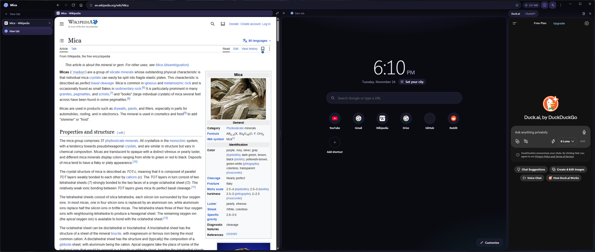
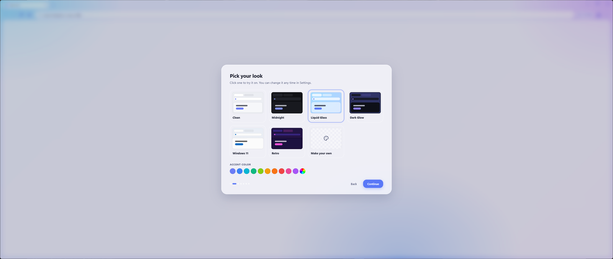
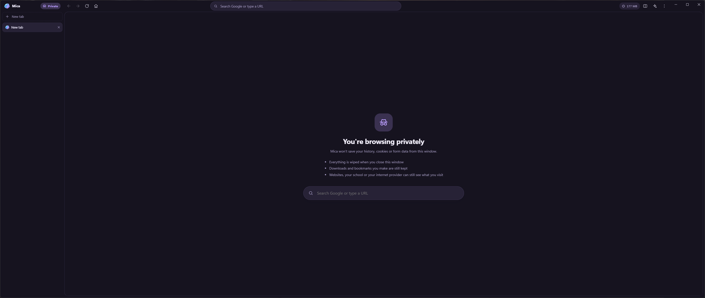
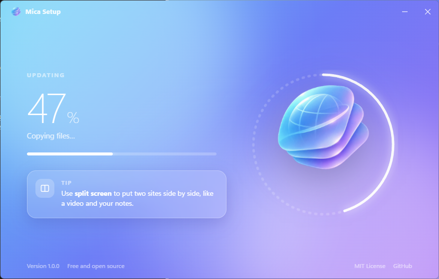

<p align="center">
  
</p>

<h1 align="center">Mica</h1>
<p align="center"><b>A fast, light, good-looking browser built to run smoothly on old laptops.</b><br>
Chromium engine · themes you can make your own · free built-in AI · no account, no ads.</p>

<p align="center">
  <a href="https://github.com/iscooliscool/mica/releases/latest"><b>⬇ Download for Windows</b></a>
</p>



## Why Mica

Most browsers assume you have plenty of memory. Mica is designed for PCs with **2–4 GB of RAM**:

- **Sleeping tabs.** Tabs you aren't using are put to sleep after a few minutes and use *zero* memory until you click them. The welcome tour recommends a timer based on your PC.
- **Restored tabs stay asleep.** Open Mica with 20 tabs from last time and only the one you're looking at loads.
- **Potato mode.** Uses Chromium's low-memory mode, fewer background processes, and turns off blur and animations. Mica offers it automatically on slower PCs.
- **Tiny app, shared engine.** Mica uses the Microsoft WebView2 (Chromium) engine that already ships with Windows 10 and 11, so the installer is about 5 MB and Mica doesn't carry a second copy of Chromium.
- **Memory meter.** See exactly how much memory Mica is using, and put background tabs to sleep with one click.

## Features

| | |
|---|---|
| 🎨 **Themes** | Clean, Midnight, Liquid Glass, Dark Glow, Windows 11 and Retro, any accent color, or build your own (colors, roundness, glass blur, spacing, font). |
| 🗂 **Tabs your way** | Tabs on top or down the side. Drag to reorder, right-click for more. |
| ✦ **Free AI helper** | Optional side panel with **Duck.ai** (Claude, GPT-4o mini, Llama and more) or **ChatGPT**. No login, no cost. Summarize the page, or highlight text → right-click → *Ask Mica AI*. Off by default; uses no memory when closed. |
| 🕶 **Private windows** | `Ctrl+Shift+N`. Nothing is saved, and everything is wiped when you close the window. |
| ◫ **Split screen** | Two sites side by side, with a draggable divider. |
| 📷 **Screenshots** | Visible area or the full page, saved and copied to the clipboard. |
| ⧉ **Picture-in-picture** | A small *Pop out* button appears at the top of videos. |
| 🛠 **Inspect** | Full Chromium developer tools: `F12`, `Ctrl+Shift+I`, or right-click → Inspect. |
| 🏠 **New tab page** | Clock, weather (no account needed), shortcuts, your own wallpaper. |
| ⭐ **Bookmarks & history** | With a bookmarks bar, and one-click import from Chrome or Edge. |
| 🧭 **Welcome tour** | Pick your look, layout and speed settings, then a quick guided tour of the real buttons. |
| 🔄 **Updates** | Checks GitHub Releases and always asks before updating. |

<p>
  
  
</p>

<p align="center"></p>

## Requirements

- Windows 10 or 11 (32-bit, 64-bit or ARM)
- .NET Framework 4.6.2 or newer (built into every Windows 10 since 2016, and Windows 11)
- Microsoft WebView2 Runtime (already on almost every Windows 10/11 PC; the installer adds it if it's missing)

No admin rights needed. Mica installs just for the current user, with its own animated installer that shows tips while it works.

## Keyboard shortcuts

| Action | Keys |
|---|---|
| New tab / close tab | `Ctrl+T` / `Ctrl+W` |
| Reopen closed tab | `Ctrl+Shift+T` |
| Private window | `Ctrl+Shift+N` |
| Next / previous tab | `Ctrl+Tab` / `Ctrl+Shift+Tab` |
| Address bar | `Ctrl+L` |
| Bookmark page | `Ctrl+D` |
| History / bookmarks / downloads | `Ctrl+H` / `Ctrl+Shift+O` / `Ctrl+J` |
| AI helper | `Ctrl+Shift+A` |
| Screenshot | `Ctrl+Shift+S` |
| Full screen | `F11` |
| Inspect | `F12` |
| Settings | `Ctrl+,` |

## Building from source

You need the [.NET SDK](https://dotnet.microsoft.com/download) (8 or newer).

```powershell
.\build.ps1                 # builds Mica and dist\Mica-<version>-Setup.exe
.\build.ps1 -Version 1.0.1  # bump the version and build
```

How it's put together:

- `src/Mica/*.cs`: the Windows app (C#, WinForms, WebView2). One window holds one web view for the interface plus one per awake tab.
- `src/Mica/ui/chrome.*`: the browser interface (tabs, toolbar, menus, welcome tour) as plain HTML/CSS/JS.
- `src/Mica/ui/pages/`: Mica's own pages: new tab, settings, history and bookmarks.
- `src/Mica/ui/shared/themes.js`: every theme is a set of CSS variables, shared by the interface and the pages.
- `src/MicaSetup/`: Mica's own installer and uninstaller. It's one self-contained `.exe` with a custom animated interface (`ui/setup.html`), install tips, a silent mode for updates, and per-user install (no admin).

Tip: set `MICA_DATA` to a folder to use a separate profile (handy for testing, or a portable USB setup).

## Privacy

Mica has no account, no telemetry and no ads. It talks to: the sites you visit; your chosen search engine; Open-Meteo for weather (only if you set a city); DuckDuckGo's icon service for shortcut icons; GitHub to check for updates (can be turned off); and Duck.ai or ChatGPT only when you open the AI panel. Tracking prevention is on by default.

## License

[MIT](LICENSE)
